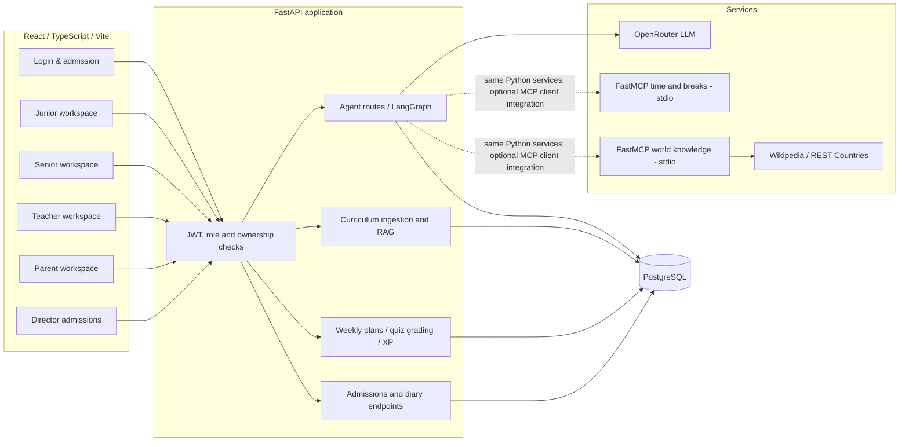
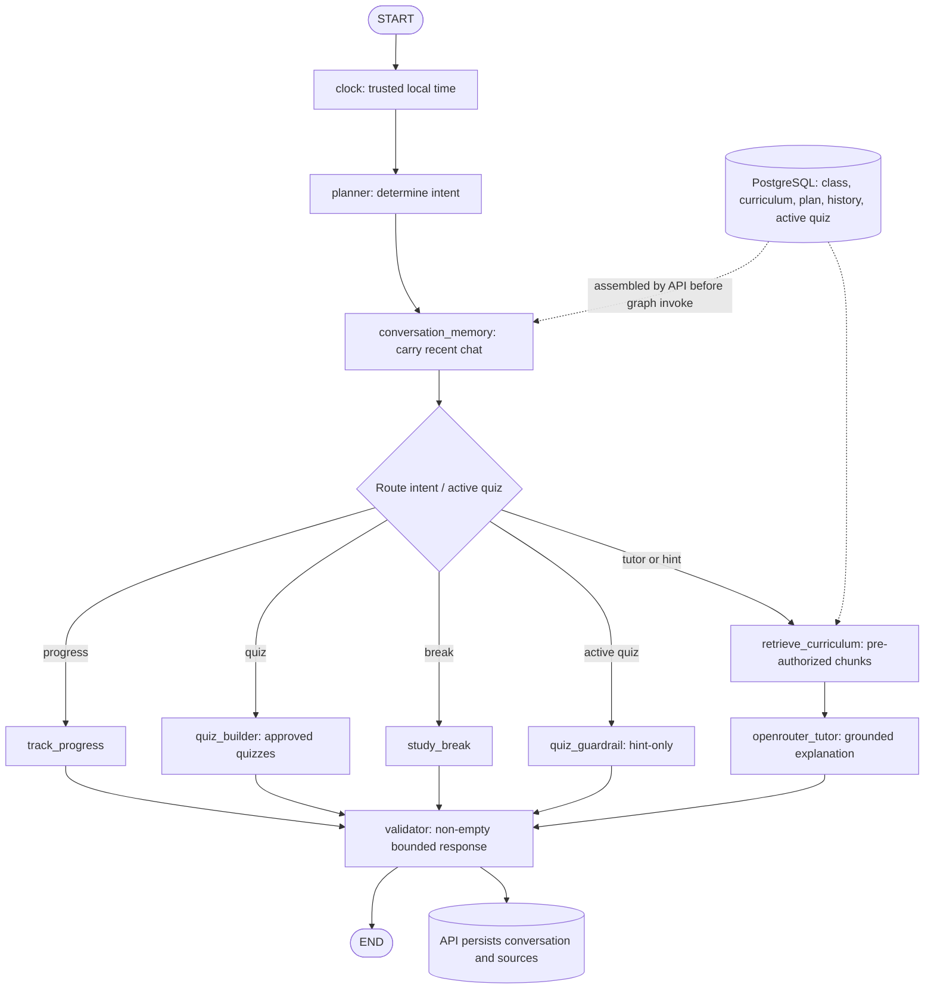
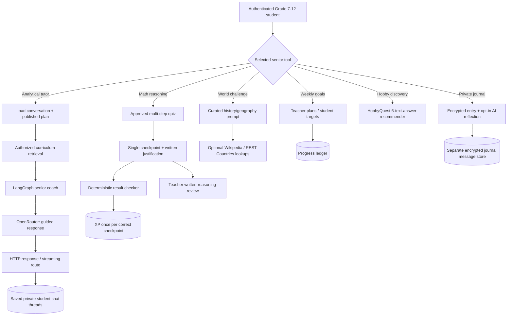
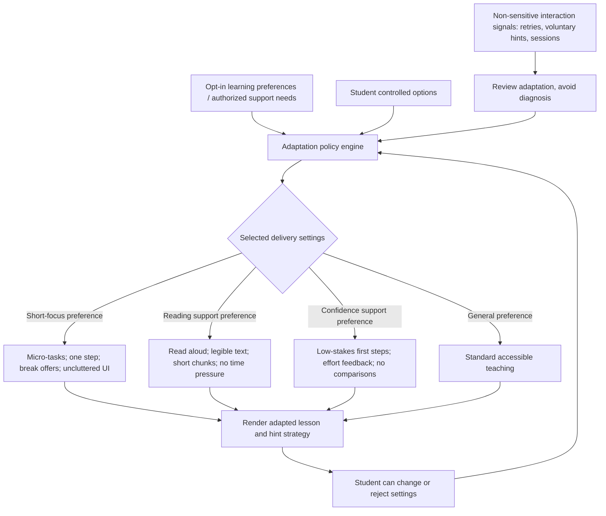
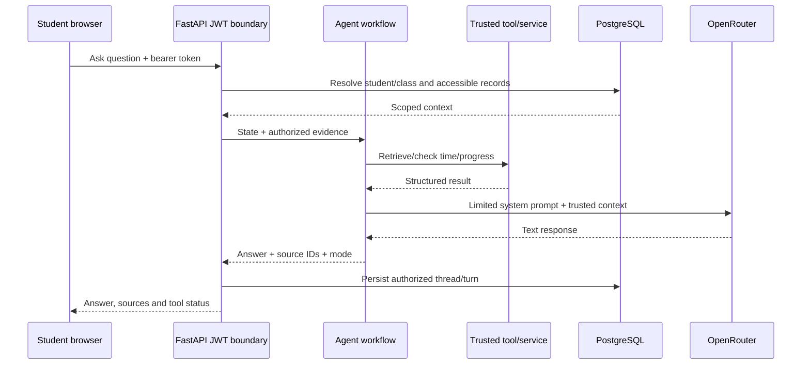
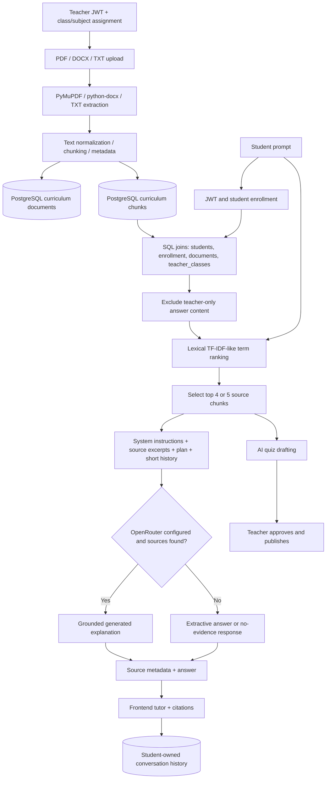
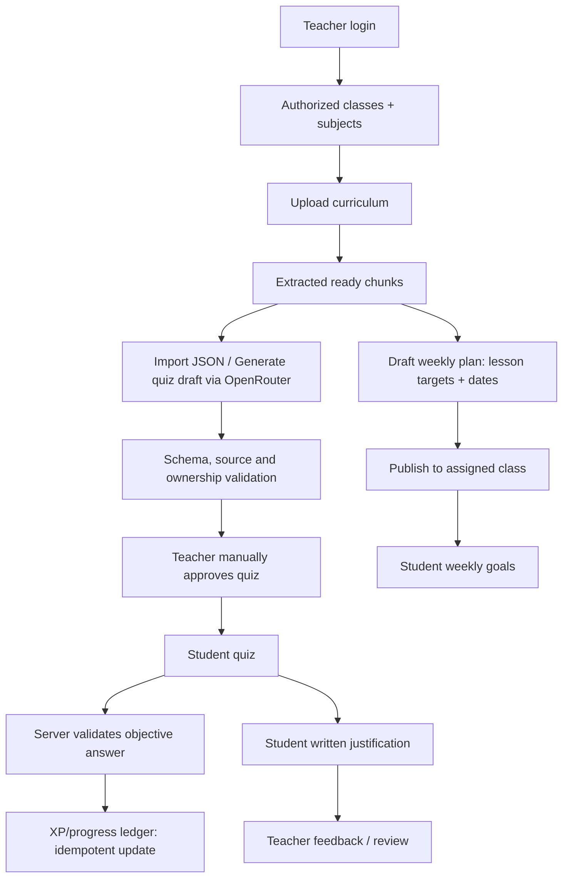
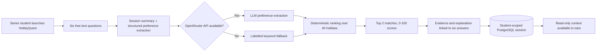
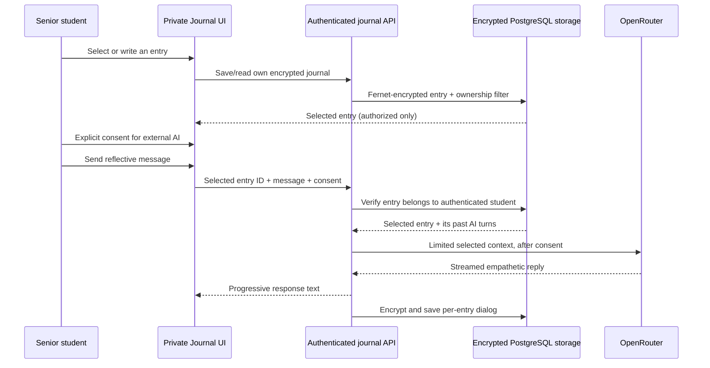
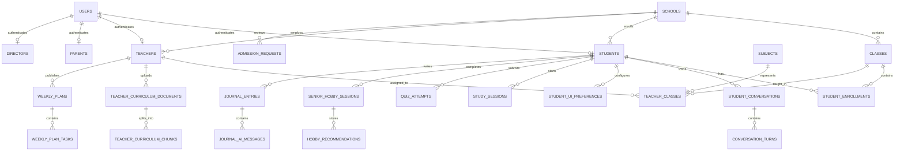

# EduNova — Agentic AI Learning Platform

**Technical architecture · Agent orchestration · MCP servers · Curriculum RAG · Adaptive tutoring · Data architecture**

> **Documentation scope and reliability.** This README documents the EduNova source snapshots and integration patches provided during development, inspected on **22 November 2026**. Core architecture, route names and implementation details were checked against the available Python/React source. Later additions (admissions, HobbyQuest, encrypted journal AI, redesigned workspaces) are maintained as **separately installable patches**, and may not be present together in any one developer checkout. The actual runtime state must be confirmed with the verification steps below. Diagrams describe logical flows; some steps are explicit API orchestration rather than separate LangGraph nodes or running MCP clients.

## Contents

1. [Product and engineering overview](#1-product-and-engineering-overview)
2. [Technology stack](#2-technology-stack)
3. [System architecture](#3-system-architecture)
4. [Junior agent: Grades 1–6](#4-junior-agent-grades-16)
5. [Senior agent: Grades 7–12](#5-senior-agent-grades-712)
6. [Adaptive learning and accessibility](#6-adaptive-learning-and-accessibility)
7. [MCP servers and tool contracts](#7-mcp-servers-and-tool-contracts)
8. [Retrieval-augmented generation](#8-retrieval-augmented-generation)
9. [Teacher, assessment and learning analytics](#9-teacher-assessment-and-learning-analytics)
10. [HobbyQuest agent tool](#10-hobbyquest-agent-tool)
11. [Private Journal and reflective AI](#11-private-journal-and-reflective-ai)
12. [Application data model](#12-application-data-model)
13. [Authentication, authorization and privacy](#13-authentication-authorization-and-privacy)
14. [Backend API map](#14-backend-api-map)
15. [Frontend architecture](#15-frontend-architecture)
16. [Repository layout](#16-repository-layout)
17. [Configuration and local startup](#17-configuration-and-local-startup)
18. [SQL migrations and patch compatibility](#18-sql-migrations-and-patch-compatibility)
19. [Testing and observability](#19-testing-and-observability)
20. [Technical competencies and engineering decisions](#20-technical-competencies-and-engineering-decisions)
21. [Limitations and roadmap](#21-limitations-and-roadmap)

---

## 1. Product and engineering overview

**EduNova** is a school-oriented, AI-assisted learning application with role-based workspaces for **students, teachers, parents and school directors**. The student experience separates a playful **junior track (Grades 1–6)** from a structured **senior track (Grades 7–12)**. Grade 6 belongs to the junior variant in the inspected application; the routing boundary is **Grades 1–6 vs. Grades 7–12**, not overlapping Grades 6–12.

### Primary capabilities

- **Curriculum-grounded tutor:** explains concepts using teacher-uploaded PDFs, DOCX and TXT, with traceable source excerpts.
- **LangGraph orchestration:** junior intent-routing graph and senior curriculum-backed coaching graph.
- **Teacher-in-the-loop content:** curriculum upload, weekly plans, generated quiz drafts, teacher approval, written reasoning review.
- **Deterministic assessment:** server-side answer checking, controlled XP, mastery/progress tracking; the LLM does not assign grades or XP.
- **Long-term student memory:** PostgreSQL chat threads, session history, weekly plans, progress records and preferences.
- **Adaptive delivery:** student-controlled reading/accessibility settings and configurable instructional scaffolding.
- **Senior exploration tools:** culture challenges, mathematical reasoning checkpoints, HobbyQuest recommender and personal goals.
- **Encrypted reflective journal:** an optional separate AI companion, with explicit consent before external-model processing.
- **Admission workflow:** public application form creates *pending admission requests*, not authenticated student accounts; school directors review them.

### Design principles

1. **Identity and authorization precede AI.** Client state never chooses its own school, class or role.
2. **Evidence before generation.** Curriculum answers are restricted to retrieved, authorized source chunks.
3. **Deterministic records as source of truth.** Grade, XP, completed tasks, deadlines and answer keys live in backend logic/data.
4. **Human control of academic publication.** Teachers approve assessments before release.
5. **Care with minors' data.** Optional sensitive journal data must remain separate from ordinary learning memory.
6. **Degrade transparently.** The core curriculum can still show source excerpts when the LLM provider is unavailable.

## 2. Technology stack

| Layer | Technology | Purpose |
|---|---|---|
| Frontend | React 19, TypeScript, Vite 6 | Role-specific, client-rendered learning workspaces |
| Icons | Lucide React; custom SVG avatars | Consistent visual system and junior companion assets |
| Backend | Python, FastAPI, Uvicorn | HTTP API, validation, business and security boundaries |
| Persistence | PostgreSQL, SQLAlchemy 2, psycopg 3 | Structured school records, learning content, chat and activity |
| Authentication | JWT (PyJWT), Argon2id password hashing | Session authentication and credential security |
| Agent orchestration | LangGraph | Typed graph state, nodes, edges and conditional routing |
| LLM | OpenRouter chat completions via HTTPX or urllib | Tutoring, quiz draft generation, optional reflective replies |
| Tool interoperability | MCP Python SDK / FastMCP | Separate, optionally launched stdio tool servers |
| Document ingestion | PyMuPDF, python-docx, text parsing | Extract PDF/DOCX/TXT classroom materials |
| Retrieval | Lexical TF-IDF-like scorer, metadata-aware SQL | Source-grounded RAG with class and teacher authorization |
| Secrets / encryption | python-dotenv, `cryptography` / Fernet | Env configuration and journal-at-rest protection |
| Validation/testing | Pydantic, pytest, TypeScript compiler | Schema validation, automated backend and UI build checks |

**Not currently verified as implemented:** a hosted vector DB, embedding generation, automatic vector indexing, Redis, Kafka, Celery, Kubernetes, general-purpose autonomous web browsing or a direct running MCP transport from every FastAPI agent route. These are *possible future upgrades*, not claims about this project.

## 3. System architecture



### Important orchestration distinction

The **MCP servers can be started independently** as `stdio` servers for MCP-compatible hosts. In the inspected FastAPI backend, time and culture routes also call their **underlying Python functions directly**. Therefore, do **not** describe every request as passing through an MCP protocol session. MCP is an integration boundary and reusable tool interface; direct in-process functions are used for some application flows.

## 4. Junior agent: Grades 1–6

**Inspected source:** `backend/app/agent/graph.py`, `backend/app/api/agent_routes.py`.

The junior agent is a real LangGraph compiled from `StateGraph(TutorState)`. Its planner is primarily a **deterministic, keyword-based router**, not an LLM-selected autonomous planner. It routes between evidence-backed tutoring, progress queries, quiz navigation, break advice and an active-quiz guardrail.



**Graph state (`TutorState`)** includes `question`, `history`, `sources`, `grade`, `plan`, `active_quiz`, `now`, `intent`, `answer`, `mode`, `used_tools` and `break_state`.

**Actual tool/intent interfaces:** `get_time`, `retrieve_curriculum`, `track_progress`, `quiz_builder`, `request_hint`, `study_break`, `study_session` and `conversation_memory`. These are logical, trusted application tools; `TOOL_SPECS` also exposes their names/icons to the UI. The LLM does **not** execute arbitrary SQL or access unscoped documents.

**Tutor prompt controls:** age-appropriate responses, short explanations, source citations, source text treated as untrusted data, refusal to reveal answers to active quizzes, analogous worked examples, no invented progress or grades. Quiz guardrails are **application-level rules** as well as prompt instructions. The model/provider can fail; in that case the app shows a transparent fallback rather than inventing a sourced answer.

**Break logic:** 30 minutes of *active* study is the default threshold, with student-initiated break start/end recorded by backend endpoints; it is a suggestion, not a forced lockout.

**Memory:** saved conversations/turns are retrieved from PostgreSQL, with a bounded number of recent messages provided to the model. UI sidebar navigation is distinct from the model's immediate context window.

## 5. Senior agent: Grades 7–12

**Inspected source:** `backend/app/agent/senior_graph.py`, `backend/app/api/senior_agent.py`, `backend/app/api/senior_reasoning.py`.

The senior tutoring graph grounds explanations in the authorized curriculum and carries verified teacher plans and recent conversation messages. Other senior tools are specialized FastAPI workflows; they are **not all nodes inside a single autonomous LangGraph**.



### Senior graph nuance

`build_senior_graph()` declares `retrieve → coach`, while the actual `senior_tutor()` function **performs authorized retrieval at the trusted API boundary** and compiles/invokes a `coach` node with evidence already passed in state. This keeps database objects out of serializable graph state. Both descriptions are useful, but the current runtime path is the latter.

### Senior interaction capabilities

| Tool | Backend behavior | Academic boundary |
|---|---|---|
| Analytical Tutor | Retrieval + contextual LLM coaching, recent threads, published plans | Hint-based guidance and curriculum sources |
| Math Reasoning | Approved multi-step question, per-step result checking | XP from deterministic validation; justification separately reviewable |
| Written Solutions | Teacher-defined prompts and submission records | Human teacher evaluates substantive writing |
| World Challenge | Curated history/geography/economics challenges | Curated answer verification; external research not automatically approved |
| Weekly Goals | Retrieve tasks and completion states | Verified persisted progress, not invented by model |
| Hobby Discovery | Separate recommender engine and sessions | Explainable preference score, not a diagnosis or aptitude prediction |
| Private Journal | Encrypted entries and optional AI reflection chat | Separate sensitive-data boundary; explicit external-model consent |

**Streaming:** `POST /api/senior/coach/stream` streams response text to the senior UI. It should be tested for provider disconnect, cancellation, partial-response persistence and transparent errors in the actual installed build.

## 6. Adaptive learning and accessibility

This is best understood as **profile-based configuration plus observed-preference feedback**, not a clinical diagnostic engine. Dyslexia, ADHD and other support needs must be **declared voluntarily** with suitable guardian/student consent; the application should never infer a diagnosis from quiz results or reading speed alone.



### Available preference fields in inspected code

`student_ui_preferences` holds `avatar_key`, `preferred_style`, `read_aloud`, `easy_words`, `short_sessions`, `calm_mode` and `large_text`. These options are concretely implemented in the junior UI/preferences API. The full adaptive graph above is an **engineering design and orchestration model**, not a claim that a standalone trained adaptation agent exists today.

**Safe deployment practices:** explicit control, accessible defaults, no automatic labeling, no disability-based score penalties, teacher/guardian governance over sensitive records, retention limits and accommodation overrides. For senior students, use mature visuals while allowing the same practical accessibility options when supported.

## 7. MCP servers and tool contracts

MCP (Model Context Protocol) standardizes tool discovery/invocation for external agent clients. EduNova includes two **FastMCP stdio servers** in the inspected source.

### 7.1 Time and study-break MCP

**Module:** `backend.app.agent.time_mcp` · **Server name:** `edunova-time`

| MCP tool | Inputs | Output / purpose |
|---|---|---|
| `get_current_datetime` | `timezone="Africa/Tunis"` | Trusted time/date representation |
| `check_study_break` | `active_seconds`, `threshold_seconds=1800` | Boolean `break_due`, threshold |

Start from project root:

```powershell
python -m backend.app.agent.time_mcp
```

### 7.2 Senior world-knowledge MCP

**Module:** `backend.app.agent.senior_mcp` · **Server name:** `edunova-senior-world-knowledge`

| MCP tool | Inputs | Behavior |
|---|---|---|
| `search_historical_entities` | `term: str` | Wikipedia entity lookup and source references |
| `get_country_facts` | `country_name: str` | REST Countries data (e.g. capitals, region, population) |
| `suggest_culture_challenge` | `domain="all"` | Curated challenge descriptor, no answer key |

```powershell
python -m backend.app.agent.senior_mcp
```

**Security/architecture:** MCP servers use **stdio**, not a public unauthenticated HTTP listener. The two servers are independent of teacher/student JWT auth unless an authorized application host wraps them. The world-knowledge MCP exposes *public read-only knowledge*, not private school/diary SQL access.

### 7.3 Tools versus MCP tools

Do not confuse a Python function, a LangGraph node, a FastAPI route and an MCP tool: these are **different interfaces**. For example, `study_break` can be an internal agent tool while `check_study_break` is exposed through FastMCP; current FastAPI routes call shared Python logic directly where appropriate.

**External MCP research options** such as Wikidata or World Bank Data360 were discussed as future integrations, but are **not documented as active connected servers** in the inspected EduNova source. No invented MCP-to-agent transport is asserted here.

### 7.4 Tool execution and safety pattern



## 8. Retrieval-augmented generation

**Inspected code:** `services/curriculum_processing.py`, `services/rag_student.py`, `agent/retrieval.py`, `api/curriculum.py`.

### 8.1 Ingestion

1. **Teacher JWT authorization** validates the teacher/class/subject assignment.
2. Accept **PDF, DOCX or UTF-8 TXT** (the curriculum UI documents a 10 MB upload cap).
3. Store original upload and metadata in `teacher_curriculum_documents`.
4. Extract text and page/heading structure; normalize and split into content chunks.
5. Persist extracted text into `teacher_curriculum_chunks` with page number, heading, index and parent document.
6. Mark document ready and make chunks available **only to authorized classes**.
7. Teacher may use chunks to propose **draft** quiz items, then approve them manually.

### 8.2 Retrieval and generation



### 8.3 What retrieval actually computes

`rank_chunks()` uses normalized tokens, stop-word removal, basic plural reduction, term counts, inverse document-frequency weighting, question coverage and boosts for hits in headings/titles. Results are sorted by score with stable ID/index tie-breaks.

**Not vector RAG:** no embedding model, FAISS, pgvector or semantic ANN index is used in this inspected pipeline. This is **lexical sparse retrieval** suitable for small classroom corpora; it may miss semantically equivalent paraphrases without shared terms.

**Source authorization** is applied *before ranking*, using current student enrollment, matching class/school, teacher assignments and document `ready` status. The retriever inspects teacher-answer-key sentinel phrases and truncates prohibited sections as a defense-in-depth measure; **separate teacher-only files and access controls remain mandatory**, since textual sentinels alone are not a robust security mechanism.

**Boundaries:** the SQL retriever limits input rows (up to 2000 in the inspected agent helper), truncates chunk text, ranks a small top-k and passes bounded excerpts to the model. If authorized evidence is absent, the agent should admit it rather than fabricate sources.

### 8.4 RAG improvements worth prioritizing

- Preserve explicit structured section types (`lesson`, `example`, `exercise`, `answer_key`) and **block answer-key ingestion** at upload time.
- Add multilingual normalization, synonym expansion, optional **hybrid BM25 + embeddings**, and a quality-checked reranker.
- Evaluate recall@k, source-support precision, teacher verification rates, leakage tests and out-of-scope handling.
- Store source offsets, page/section anchors, content hashes and ingestion version for reproducible citations.
- Introduce caching and incremental re-ingestion only after permission-scoped invalidation is designed.

## 9. Teacher, assessment and learning analytics

### 9.1 Teacher flow



### 9.2 Grade 11 rigorous mathematics

The Grade 11 quiz bank comprises **multi-step checkpoints**, expected intermediate values, hints, source/lesson identifiers and teacher-visible justifications. Frontend presents one step at a time; backend validation governs correctness, step unlocking and XP. Correct computation is **not automatically equivalent to a rigorous proof**: teachers inspect the explanation and supply feedback.

**Academic integrity:** only approved questions are student-visible; hidden answer keys are server-side. Avoid crediting the same solved step twice. All award operations should be protected by database uniqueness/transactions, not only a disabled frontend button.

### 9.3 Analytics model

Track: assigned/published weekly tasks, quiz attempts, hints used, completed distinct checkpoints, active study sessions, break events and XP ledger. Published completion counts come from records; the assistant may summarize these but may not modify them through free-text conversation.

## 10. HobbyQuest agent tool

The user-supplied recommender is preserved as a **specialized deterministic ranking service** rather than a new generic chatbot. The integration patch contains modules under `backend/app/agent/hobbyquest/` (`catalog.py`, `recommender.py`, `edunova_adapter.py`, `agent_tool.py`), plus a senior UI and SQL migration 14.



**Why two layers?** NLP turns unstructured responses into understandable preferences, while deterministic scoring supports explanation/audit and a consistent ranking formula. Scores indicate heuristic affinity, **not a validated aptitude or mental-health assessment**. The no-keyword/low-confidence fallback should be presented as a limitation.

### Setup note

Apply the HobbyQuest patch and `sql/14_hobbyquest_free_text.sql` **only if not already installed**. The integration patch installer merges with current source; review diffs to avoid replacing later UI changes. Current checkout must be checked for presence of `backend/app/agent/hobbyquest` and its API endpoints.

## 11. Private Journal and reflective AI

**Two versions exist in project history:** initial encrypted local journal and later **opt-in external AI companion**. Documentation must reflect **the installed version**.

### Current intended architecture after journal AI patch



The separate **Journal AI Companion patch** adds `/api` journal-chat routes and migration `16_journal_ai_companion.sql`. It is intentionally not merged into ordinary academic conversation memory. The UI patch adds entry navigation, writing mode and a separate reflect mode.

**Required key:** `EDUNOVA_DIARY_FERNET_KEY`. Persist the original key securely; changing it without re-encrypting data makes old entries unreadable. Configure `OPENROUTER_API_KEY` and `OPENROUTER_MODEL` for live replies. Avoid printing or checking secrets into Git.

**Consent and safeguarding:** private student journal entries may contain sensitive disclosures. They must not automatically go to a third-party LLM when simply opened. The consent control should be meaningful, age/guardian-policy compliant and revocable. The AI uses supportive, nonjudgmental prompts, but **is not a counsellor** and no current implementation guarantees live crisis monitoring, external notifications or staffed interventions. `request-human-help` stores a request; this is not proof anyone has been alerted. Trusted contacts and sensitive entries must not be silently exposed to teachers/parents.

## 12. Application data model

The full database is defined in **ordered SQL migrations**, not a single ORM-generated schema. Names below are logical groups; consult `sql/*.sql` for exact column spellings and constraints. Some newer tables only exist after their individual patches have been installed.



> The ER diagram is a **conceptual relationship view**, not a literal verified physical database schema. For example, actual table naming can differ across agent and journal migrations; refer to `\dt public.*`, `information_schema.columns` and individual SQL files before writing migrations or JOINs. `JOURNAL_AI_MESSAGES` and `ADMISSION_REQUESTS` only exist after the relevant later patches.

### Data domains

| Domain | Representative stored facts |
|---|---|
| Identity and tenancy | Users, roles, schools, director/teacher/parent/student links |
| Enrollment | Class grade, active student enrollment, assigned teachers and subjects |
| Curriculum | Original document, status, extracted source chunks, location metadata |
| Learning plans | Published weeks, tasks, student completion, reward ledger |
| Tutoring | Conversations, turns, source references, tool/mode attribution |
| Assessment | Draft/approved questions, answer keys, attempts, written steps, review |
| Experience | Avatar, theme, accessibility preferences, session and breaks |
| Discovery | Hobbies, student response sessions, ranked recommendations |
| Reflection | Encrypted diary entries, encrypted per-entry AI chat, trusted contacts |
| Admission | Application details, selected interests/needs, consent, review status |

### Example minimal record relationships

An authenticated `user_id` resolves to a `student_id`; student enrollment resolves school/class/grade; teacher assignments authorize which documents the student can read; quiz attempts reference only teacher-approved questions; conversation threads are constrained to their student owner. An **admission applicant has no active student user ID** until a director completes a separate provisioning workflow.

## 13. Authentication, authorization and privacy

### Authentication flow

1. `POST /api/auth/login` validates credentials (Argon2id hash), returning signed JWT and user information.
2. `GET /api/auth/me` resolves the current account.
3. `GET /api/spaces/{student|teacher|parent|director}` derives the accessible role-specific workspace server-side.
4. Student grade/enrollment determines junior/senior route; no client-only role switch bypasses authorization.
5. Backend endpoints revalidate role and record ownership for every sensitive operation.

### Required production controls

- JWT expiration/revocation strategy, TLS, security headers, cookie/token storage threat model and CSRF defenses as appropriate.
- Row-ownership and school tenancy checks in **every** SQL statement/API, including downloadable original documents.
- Teacher-only answer-key separation, prompt injection defenses and output filtering.
- Provider/data-processing review before submitting minors' curriculum answers or journal content to external LLM services.
- Admission abuse controls: rate limits, bot protection, privacy notices and verifiable guardian authority.
- Encryption secret rotation plan and separation of duties for diary administration.
- Audit logs that **exclude** plaintext private journal content and credentials.

### Specific areas to validate

Do not assume a prompt instruction alone guarantees that no quiz answers leak. The RAG ingestion/ranking pipeline contains textual answer-key sentinel filtering, but a teacher could upload a differently labeled answer sheet. Build explicit document visibility classes and adversarial tests before deployment.

## 14. Backend API map

All routes below are shown with `/api` prefix from available backend module patterns. Patch endpoints require local installation verification.

| Purpose | Representative endpoints |
|---|---|
| Authentication | `POST /api/auth/login`, `GET /api/auth/me`, `POST /api/auth/logout` |
| Role workspaces | `GET /api/spaces/student`, `/parent`, `/teacher`, `/director` |
| Curriculum | `POST /api/curriculum/teacher/upload`, `GET /api/curriculum/teacher/documents`, `GET /api/curriculum/teacher/documents/{id}/chunks` |
| Student RAG | `GET /api/student/rag/documents`, `POST /api/student/rag/ask` |
| Junior agent | `POST /api/agent/student/chat`, `GET /api/agent/student/conversations`, `GET /api/agent/student/progress` |
| Teacher planning | `POST /api/agent/teacher/plans`, `POST /api/agent/teacher/plans/{id}/publish` |
| Junior quizzes | `POST /api/agent/teacher/quizzes/generate`, `POST /api/agent/teacher/quizzes/{id}/approve`, `POST /api/agent/student/quizzes/{id}/answer` |
| Breaks | `GET /api/agent/student/break-status`, `POST /api/agent/student/break/start`, `/end` |
| Senior tutor | `POST /api/senior/coach`, `POST /api/senior/coach/stream`, `GET /api/senior/threads` |
| Senior reasoning | `POST /api/senior/reasoning/teacher/import`, `POST /api/senior/reasoning/student/quizzes/{id}/answer` (verify router prefix) |
| Senior culture/goals | `GET /api/senior/culture/challenge`, `POST /api/senior/culture/answer`, `GET /api/senior/goals` |
| Senior journal | `GET /api/senior/diary`, `POST /api/senior/diary` |
| Admissions patch | `GET /api/admissions/options`, `POST /api/admissions/apply`, `GET /api/admissions/requests`, `PATCH /api/admissions/requests/{id}` |

**Route caution:** FastAPI mounts routers with prefixes in `backend/app/main.py`; confirm actual paths with **`http://127.0.0.1:8000/docs`** and `app.openapi()` after patches. Do not assume conceptual route names above guarantee the specific combination is installed.

## 15. Frontend architecture

### Main building blocks

- `frontend/src/App.tsx`: root role routing, login/admission entry, junior and teacher workspaces.
- `frontend/src/components/AgentWorkspace.tsx`: junior agent chat, teacher planning and lesson interactions.
- `frontend/src/components/SeniorAgentStudio.tsx`: senior tools, tutor, history, hobby and diary integration.
- `frontend/src/components/SeniorMathTeacherStudio.tsx`: rigorous quiz authoring and written reasoning review.
- `frontend/src/components/DiaryAICompanion.tsx`: optional, after journal AI patch.
- `frontend/src/components/StudentAdmission.tsx`: optional, after admissions patch.
- Scoped CSS: `junior-viewport.css`, `senior-fullscreen.css`, `agent.css`, `senior.css`, journal styles, teacher viewport styles.

### UI boundaries

- **Junior:** viewport-height lesson, chat center, collapsible left companion, collapsible right conversation history, internal message scrolling.
- **Senior:** full-page tutor, collapsible tools on left and conversation history on right; specialized pages for math, goals, HobbyQuest, journal.
- **Teacher:** classes/assignments/curriculum/quizzes/reasoning as distinct workspaces; keep the dashboard within the viewport; long forms scroll *inside* panels if necessary.
- **Admissions:** public login CTA leading to two-step applicant form; requests remain pending for the director.

### Critical integration lessons from development

Recent patch regressions included **a Sign Up CTA inserted after the wrong `</form>`** (inside `CurriculumManager`), leading to missing `setShowAdmission`, and a **missing `junior-viewport.css` import** after a senior patch. Never deploy a script that blindly replaces the first `</form>` or whole `main.tsx`; anchor changes by exact component/function and test the active rendered login route. `npm run build` should be a required gate after every frontend patch.

## 16. Repository layout

```text
upside_hack/
├── backend/
│   ├── app/
│   │   ├── main.py
│   │   ├── api/
│   │   │   ├── auth.py
│   │   │   ├── login_spaces.py
│   │   │   ├── curriculum.py
│   │   │   ├── student_rag.py
│   │   │   ├── agent_routes.py
│   │   │   ├── senior_agent.py
│   │   │   ├── senior_reasoning.py
│   │   │   └── diary_ai.py                # after patch 16
│   │   ├── agent/
│   │   │   ├── graph.py                   # junior LangGraph
│   │   │   ├── senior_graph.py
│   │   │   ├── retrieval.py
│   │   │   ├── quiz_tools.py
│   │   │   ├── reasoning_grader.py
│   │   │   ├── time_tools.py
│   │   │   ├── time_mcp.py
│   │   │   ├── senior_mcp.py
│   │   │   ├── senior_culture.py
│   │   │   └── hobbyquest/                # after patch 14
│   │   ├── services/
│   │   │   ├── curriculum_processing.py
│   │   │   └── rag_student.py
│   │   ├── db/ core/ security/ models/ schemas/
│   └── tests/
├── frontend/
│   ├── src/
│   │   ├── App.tsx
│   │   ├── main.tsx
│   │   └── components/
│   ├── public/avatars/
│   ├── package.json
│   └── vite.config.ts
├── sql/
│   ├── initial.sql
│   ├── 02_auth_access.sql ... 13_exellence_grade11_math_assignment.sql
│   ├── 14_hobbyquest_free_text.sql     # if integrated
│   ├── 15_student_admission_requests.sql  # if integrated
│   └── 16_journal_ai_companion.sql    # if integrated
├── curriculum/grade11/
├── scripts/
├── requirements.txt
├── .env.example
└── README.md
```

## 17. Configuration and local startup

### Requirements

- Python 3.13-compatible environment; PostgreSQL; Node.js and npm; `psql` in PATH for migration commands.
- Existing application database, school setup, account seed and completed migrations as applicable.

### Environment example

Create a root `.env` with the **keys accepted by your installed config module**. Never commit it.

```dotenv
# Example names; check backend/app/core/config.py for precedence.
DB_HOST=localhost
DB_PORT=5432
DB_NAME=Astrafenix_AI
DB_USER=postgres
DB_PASSWORD=YOUR_LOCAL_DB_PASSWORD

JWT_SECRET=USE_A_LONG_RANDOM_SECRET
OPENROUTER_API_KEY=YOUR_OPENROUTER_API_KEY
OPENROUTER_MODEL=openai/gpt-4o-mini
EDUNOVA_DIARY_FERNET_KEY=YOUR_EXISTING_FERNET_KEY
```

OpenRouter and Fernet keys are **optional only for features that do not invoke them**. A configured journal entry store requires Fernet; a live journal AI reply additionally requires OpenRouter. Do not regenerate Fernet if old entries exist.

### Backend

```powershell
cd C:\Users\Adam\Desktop\upside_hack
.\.venv\Scripts\Activate.ps1
python -m pip install -r requirements.txt
python -m pytest backend/tests -q
python -m uvicorn backend.app.main:app --reload
```

### Frontend (second terminal)

```powershell
cd C:\Users\Adam\Desktop\upside_hack\frontend
npm install
npm run build
npm run dev
```

- UI: `http://127.0.0.1:5173`
- API docs: `http://127.0.0.1:8000/docs`
- Vite proxies `/api` to FastAPI (inspect `vite.config.ts` for target).

### MCP servers (optional independent processes)

```powershell
python -m backend.app.agent.time_mcp
python -m backend.app.agent.senior_mcp
```

A production MCP host needs explicit stdio process configuration and tool permission boundaries. Launching a server **does not automatically connect** it to the FastAPI tutor.

## 18. SQL migrations and patch compatibility

| File | General purpose |
|---|---|
| `initial.sql` | Initial schema **(destructive reset; never rerun on populated database)** |
| `02_auth_access.sql` | Auth and enrollment constraints |
| `03_learning_foundations.sql` | Core learning features |
| `04_demo_seed.sql` / `05_exellence_school.sql` | Demo datasets and Exellence Academy seed (use cautiously) |
| `06_exellence_validate.sql` | Validation helper |
| `07_teacher_curriculum.sql` | Teacher documents and chunk records |
| `08_edunova_experience.sql` | UI preference and study session records |
| `09_langgraph_agent.sql` | Junior agent plans, quizzes, chat and XP |
| `10_senior_agent.sql` | Senior coach, culture, goals, diary and related records |
| `11_senior_hobby_recommender.sql` | Original senior hobby module |
| `12_grade11_reasoning_history.sql` | Multi-step Grade 11 reasoning and history enhancements |
| `13_exellence_grade11_math_assignment.sql` | **Test-only** 11A mathematics teacher assignment |
| `14_hobbyquest_free_text.sql` | New six-answer HobbyQuest sessions |
| `15_student_admission_requests.sql` | Pending applicant requests and director workflow |
| `16_journal_ai_companion.sql` | Encrypted AI replies linked to journal entries |

**Do not blindly run all migrations.** Use migration tracking / database inspection to determine which exist. The development patches are additive but may contain assumptions about current tables and frontend files. Always back up before installation and review generated diffs.

```powershell
# Example: only when migration 16 is not already applied
psql -U postgres -d Astrafenix_AI -v ON_ERROR_STOP=1 -f .\sql\16_journal_ai_companion.sql
```

A proper long-term migration system (Alembic or another audited approach) is recommended for production.

## 19. Testing and observability

### Core tests

```powershell
python -m pytest backend/tests -q
python -m scripts.agent_smoke_test
cd frontend
npm run build
```

Some patch packages also have dedicated `tests/` (notably HobbyQuest); run those independently. Historical development logs mentioned passing tests, but **test counts are version-dependent** and are not proof that the current checkout has the same passing result.

### End-to-end acceptance matrix

| Test | Expected behavior |
|---|---|
| Junior RAG authorization | Adam sees only documents assigned to his enrolled class |
| Out-of-scope curriculum | Response explicitly indicates missing evidence |
| Active quiz integrity | Hint provided; answer key not disclosed |
| Quiz idempotency | Repeating a correct submission does not earn XP again |
| Teacher approval | Draft quiz invisible to student until approval |
| Senior coaching | Mehdi receives guidance using approved plans and source excerpts |
| Streaming | Text arrives progressively; disconnect handled without data corruption |
| HobbyQuest | Six answers, top two scored explanations and stored student session |
| Journal privacy | Student A cannot read student B's entries/messages |
| Journal model consent | No journal text sent to OpenRouter before opt-in |
| Admission workflow | Request saved pending; no automatic account created |
| Signup integration | Button appears on actual login panel; absent from teacher uploader |
| Responsive UX | Full page fits target laptop viewport; inner content retains accessibility |

### Recommended observability

- Structured logs: request ID, duration, role, agent mode, tool selected, token usage/latency **without private diary bodies**.
- Metrics: retrieval hit rate, citation presence, LLM fallback frequency, quiz approval rate, latency percentiles, error/timeout rates, model budget.
- Learning diagnostics: progress derived from deterministic records; avoid ranking students by inferred mental state or neurotype.
- Trace correlation: thread/session identifier and tool timings, with retention/consent controls for minors.

## 20. Technical competencies and engineering decisions

This project demonstrates practical skills in:

| Competency | Implementation example |
|---|---|
| **Agentic workflow design** | LangGraph typed state, explicit edges, conditional routing and tool guards |
| **Multi-agent specialization** | Distinct junior and senior tutoring policies and independent specialized tools |
| **Tool calling / MCP** | FastMCP stdio servers, tool schemas, reusable read-only services |
| **RAG engineering** | Document parsing, chunking, SQL-scope filtering, ranking, grounded prompts, source references |
| **Prompt engineering** | Age-specific system instructions, hints-first pedagogy, untrusted-source handling |
| **Human-in-the-loop AI** | Teacher-reviewed generated quiz drafts and written explanations |
| **Structured extraction** | HobbyQuest LLM preference parsing with deterministic scoring fallback |
| **Agent memory** | Persistent conversation threads, short context windows, saved plans and progress |
| **Transactional systems** | PostgreSQL ownership relationships, idempotent XP and quiz submissions |
| **Backend architecture** | FastAPI routers, Pydantic models, SQLAlchemy transactions, JWT access control |
| **Frontend engineering** | Role-aware React routing, responsive scoped CSS, streaming display, sidebar state |
| **Security/privacy engineering** | Argon2id, role boundaries, encrypted journal, consent, careful external API use |
| **Quality engineering** | pytest, TypeScript checks, migration controls and end-to-end scenarios |

**Engineering judgment:** not every action needs an LLM. Time calculations, quiz grading, XP, student enrollment, source authorization and request status belong in deterministic code; use models for the tasks that benefit from language understanding and adaptive explanation.

## 21. Limitations and roadmap

### Known current limitations

- **MCP integration:** available FastMCP servers are not proof of full dynamic MCP client tool calling inside every LangGraph run.
- **Retrieval:** the verified baseline is lexical, not embedding-powered semantic retrieval; source filters should be strengthened for answer-key safety.
- **Adaptation:** preference presets and scaffolds are not a medically validated disability classifier.
- **Teacher marking:** objective math checkpoints can be scored automatically; full proof quality still requires teacher review.
- **Privacy:** production deployment to minors requires guardian consent processes, vendor/legal review, retention controls and safeguarded escalation.
- **Admissions:** request submission does not yet prove an automated enrollment or outbound contact process.
- **Patch convergence:** code came from incremental snapshots/ZIP installers. There is no single confirmed deployment containing all additions until the current checkout is merged and validated.

### Suggested engineering roadmap

1. **Consolidate branch and migrations:** one canonical repository, reproducible migration history, consistent router registration and frontend integration tests.
2. **Upgrade retrieval quality:** document classification, hybrid retrieval, citations with page offsets, evaluation dataset, adversarial prompt-injection tests.
3. **Establish typed tool interfaces:** Pydantic input/output contracts, tool permission registry, optional MCP client wiring, timeouts and trace IDs.
4. **Add reliable streaming lifecycle:** cancellation, partial-result recovery, durable saved turns, provider backoff, safe fallback.
5. **Formalize adaptation policy:** documented preference rules, accessibility tests, caregiver controls where appropriate, no inferred diagnoses.
6. **Production safeguarding/privacy:** guardian consent and human response process before deploying the journal broadly to minors.
7. **Observability and cost controls:** request traces, model budgets, caching of public results, retrieval metrics and systematic regression tests.
8. **Deployment maturity:** CI build/test matrix, managed secrets, backup/key-rotation plan, TLS, rate limiting and operational incident playbooks.

---

## Summary

**EduNova combines school-authorized retrieval, LangGraph tutoring, deterministic academic tools and specialized AI interfaces in a single role-aware learning platform.** Its strongest architectural feature is the division between **probabilistic AI language generation** and **deterministic school/assessment state**. Curriculum permissions, quiz keys, XP, progress, admissions and encrypted journal ownership remain backend responsibilities; the model provides guidance and reflection within those boundaries.

*Technical README assembled from inspected EduNova source and available post-baseline patch documentation, 22 November 2026.*
