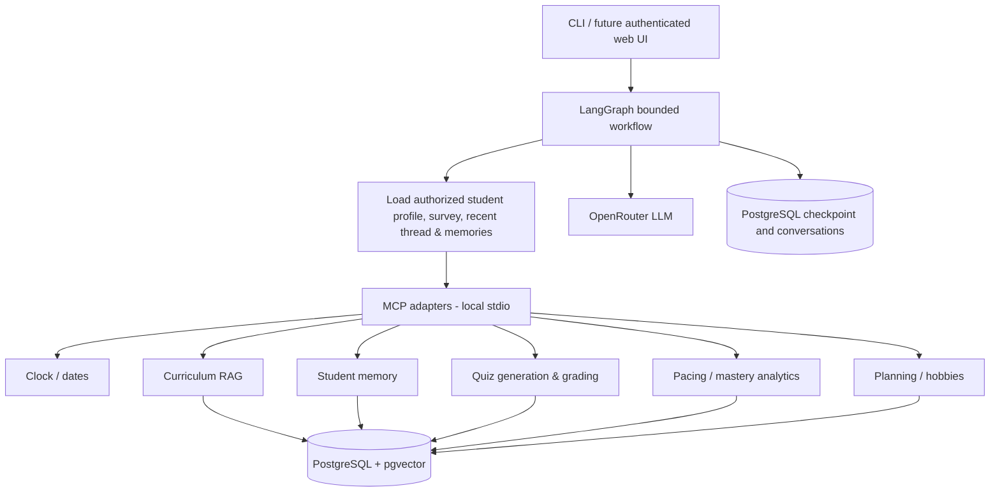

# Student Assistant architecture

## The learning contract

Two age-adapted experiences: **junior 6–12** uses an adventure tone, shorter activities and concrete hints; **senior 13–18** uses guided Socratic reasoning and hints rather than immediately revealing math answers. Curriculum currently consists of **three Grade 3 workbooks only**, therefore senior tutoring is intentionally blocked from claiming age-appropriate curricula until appropriate documents are ingested.

## Components

## MCP contracts

Each MCP server is launched as a stdio subprocess by `MultiServerMCPClient`, using the same Python virtual environment. These are *application services*, not general third-party public MCP servers. The tool surface deliberately excludes arbitrary SQL, filesystem write, identity changes, unsupervised student-data export, and parent notifications.

| Server | Tools | Notes |
|---|---|---|
| clock | `get_current_datetime` | Actual timezone-local clock, next-week Monday/Sunday |
| curriculum | `search_lessons`, `list_course_adventures` | Grade-3 PDF chunks with page and document provenance |
| memory | `get_student_context`, `retrieve_learning_memories`, `save_learning_observation` | Only authorized student; learning consent required for durable memory |
| quiz | `create_quiz_draft`, `get_question`, `submit_answer` | Prototype quiz generation, deterministic grading, mastery updates |
| analytics | `get_pacing_recommendation`, `record_activity_event`, `get_mastery_profile` | No clinical attention inference; timing is event-based and opt-in |
| planning | `list_study_goals`, `create_weekly_goal`, `get_hobby_catalog`, `get_hobby_questions`, `rank_hobbies_from_six_answers` | User can explicitly save goals; six-answer hobby recommendations with provenance |

## Knowledge storage

`public.*` tables are **your existing school database**. Migration `sql/02_student_assistant_extension.sql` is additive and DOES NOT execute the destructive DROP statements of `01_schema.sql`.

`assistant.course_documents` keeps document digest and metadata; `assistant.course_chunks` retains page number, adventure number/title, text, full-text search vector and a `vector(384)` FastEmbed embedding. Retrieval is hybrid lexical + cosine similarity, filtered to the subject and grade.

`assistant.concept_mastery` stores exact outcomes for concepts, attempts and hints; `assistant.learning_memories` holds consented, concise educational observations. `assistant.conversation_turns` is explicit thread history and `AsyncPostgresSaver` checkpoints graph progress in the same database. Pacing depends on explicit student activity events, **not inferred diagnoses or hidden surveillance**.

## Ingestion

PyMuPDF extracts text from each PDF; the parser identifies adventure headings, keeps page boundaries, and produces ~1400-char chunks with overlap. Embeddings use `sentence-transformers/all-MiniLM-L6-v2` through FastEmbed (384-dimensional). The model must be consistent between ingestion and query. The first run downloads model weights; offline environments must pre-cache the embedding model. PDF checksum makes imports repeat-safe.

## Data safety

All database access is wrapped in fixed SQL methods and `student_id` checks. The CLI accepts a student ID for local testing only. **Do not put this CLI behind a public HTTP endpoint.** A real deployment requires OIDC login, server-derived student identity, teacher/guardian permissions, child-specific consent, tenant isolation, and an explicit RLS implementation with a non-owner role. RLS is enabled on sensitive tables as groundwork, but owner/superuser bypass means this starter is NOT a finished production access-control system. Existing `student_survey.consent` should not be treated as an implicit opt-in for long-term chat storage or pacing signals.

## Latency

MCP stdio subprocesses may be started per tool invocation. This is correct for local demos but not scalable. Production should keep reusable sessions/streamable HTTP services; pool DB connections, batch embeddings, cache course retrieval, and limit tool calls.

## Pedagogical validation

LLM-generated quizzes are at prototype level. The answer key is structure-checked and grading is deterministic, but the **correctness of model-generated questions is not independently mathematically verified**; teacher approval is required before real classroom/high-stakes use. Source attribution is required in tutor prompts. For older students without senior-level curriculum, the assistant declines to pretend Grade 3 resources are suitable.
